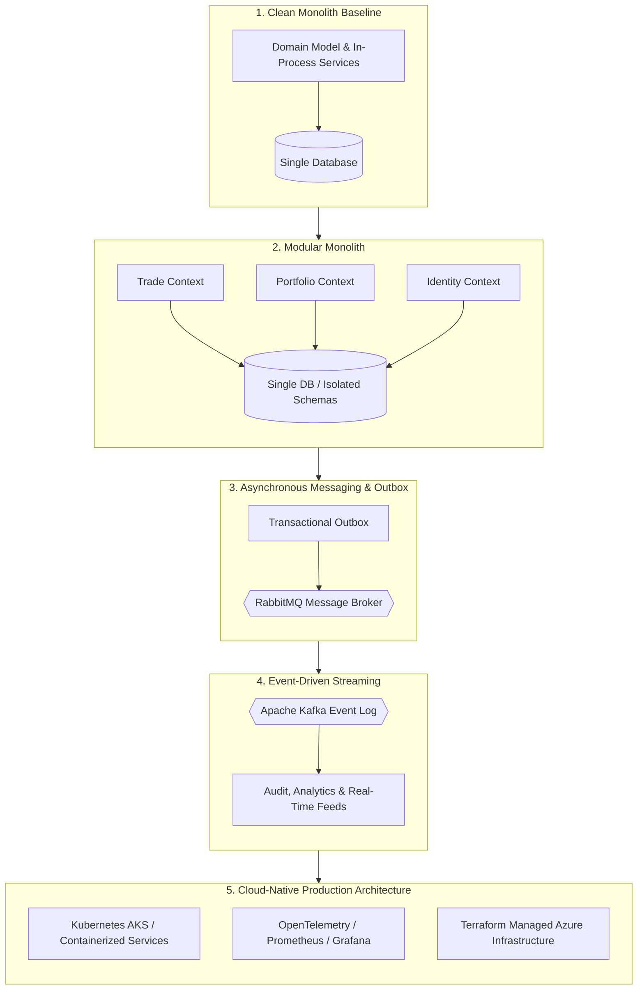

# Project Charter — TradeFlow

## 1. Project Purpose

**TradeFlow** is a production-grade software engineering laboratory designed to elevate an experienced software engineer to senior, staff, and principal engineering capabilities.

Rather than building disposable toys or following tutorial shortcuts, this project builds a mission-critical, high-concurrency financial and trade management platform. The application serves as the vehicle for mastering distributed systems design, domain-driven design, continuous testing strategies, resilience patterns, security architecture, cloud infrastructure, and operational reliability under real-world pressures.

---

## 2. Learning Philosophy

1. **Depth Over Breadth**: Surface-level acquaintance with syntax or frameworks is insufficient. True mastery is understanding failure boundaries, concurrency bottlenecks, transaction semantics, and memory/network characteristics.
2. **Socratic Inquiry**: Learning happens through active reasoning, hypothesis testing, and defending design decisions rather than passively absorbing solutions.
3. **Problem-Driven Evolution**: Technologies and architectural patterns are never adopted because they are fashionable. They are introduced only when current architectural boundaries experience genuine friction or fail to satisfy new constraints.
4. **Continuous Quality & Resilience Through Testing**: Testing is a first-class engineering axis, not an afterthought. Testing decisions—what to test, what to avoid testing, mock vs. real dependency, unit vs. integration vs. E2E—are evaluated on every single feature.
5. **Resilience Through Chaos**: Systems are only as resilient as their behavior under failure. Simulating realistic failure modes (partial network partitions, broker outages, stale caches, split-brain scenarios) is central to the curriculum.

---

## 3. Target Seniority & Skill Profile

This project is tailored for an **experienced software developer** advancing toward **Senior / Staff / Lead Engineer** and **Solutions Architect** roles.

Key competencies targeted:
- **System Architecture**: Designing bounded contexts, modular monoliths, distributed services, and event streams.
- **Data Integrity & Consistency**: Navigating ACID vs. BASE, eventual consistency, the Transactional Outbox pattern, idempotency, and distributed sagas.
- **Comprehensive Testing Discipline**: Rigorously evaluating test levels, using Testcontainers for realistic dependencies, designing resilient messaging/DLQ tests, browser automation with Playwright, and enforcing boundaries with NetArchTest.
- **Enterprise Security**: Implementing modern identity standards (OAuth2, OpenID Connect, JWT, SSO, role-based and attribute-based access control) and automated security tests.
- **High-Throughput Streaming & Messaging**: Orchestration vs. choreography, RabbitMQ exchanges/queues vs. Kafka partitioned logs.
- **Performance & Scalability**: Multi-tier caching with Redis, query optimization, connection pooling, and latency profiling under load (k6).
- **Reliability & Observability**: Distributed tracing, metrics instrumentation, health checks, structured logging, and incident diagnosis.
- **Cloud-Native Infrastructure**: Infrastructure as Code (Terraform), container orchestration (Kubernetes/Docker), and cloud architectures (Azure).
- **Technical Communication**: Articulating trade-offs, defending designs, and presenting architecture in crisp, interview-ready English.

---

## 4. Main Technologies to Study

| Domain | Target Technologies |
| :--- | :--- |
| **Backend Core** | .NET 8 / 9, C#, ASP.NET Core Web API, Minimal APIs, Background Workers |
| **Data Persistence** | PostgreSQL, Entity Framework Core, Dapper (high-performance paths) |
| **Distributed Caching** | Redis (caching patterns, distributed locks, rate-limiting) |
| **Messaging & Queues** | RabbitMQ (MassTransit / Wolverine, AMQP, Dead-Letter Exchanges) |
| **Event Streaming** | Apache Kafka (Partitioning, consumer groups, offset management) |
| **Identity & Security** | OAuth2, OpenID Connect (OIDC), Keycloak / Duende, JWT validation |
| **Frontend Architecture**| React, TypeScript, State Management, Real-time WebSockets / SignalR |
| **Testing & Verification**| xUnit, FluentAssertions, Testcontainers, NetArchTest, Playwright, k6 / NBomber, WireMock.Net |
| **Observability** | OpenTelemetry, Prometheus, Grafana, Jaeger / Aspire Dashboard |
| **Containers & K8s** | Docker, Docker Compose, Kubernetes (Deployments, Services, Ingress, ConfigMaps) |
| **Infrastructure as Code**| Terraform, Azure Cloud Services (AKS, Azure SQL/PostgreSQL, Key Vault) |

---

## 5. Testing Philosophy: Meaningful Confidence Over Code Coverage

A foundational pillar of this learning environment is that **testing is architectural**:
- **Confidence Over Coverage**: 95% line coverage with brittle mock-heavy tests provides zero real-world confidence. We prioritize high-value tests that protect critical invariants and detect production failures.
- **Appropriate Test Levels**: Every test belongs at the lowest level that provides high confidence:
  - Unit tests for pure business logic and invariants.
  - Integration tests with **Testcontainers** for real PostgreSQL/Redis/RabbitMQ/Kafka interactions.
  - API tests for contracts, validation, and authorization pipelines.
  - Contract tests for inter-service and event schema evolution.
  - Targeted E2E tests with **Playwright** for critical full-stack user journeys.
  - Architecture tests with **NetArchTest** to prevent architectural erosion.
- **Critical Scrutiny of Every Test**: We question whether each test protects behavior or leaks implementation details, and whether it introduces long-term maintenance drag.

---

## 6. Code-Reading-First Philosophy

In this learning environment:
- **The AI generates the majority of implementation and test scaffolding**: Writing repetitive boilerplate does not build senior-level judgment.
- **The developer acts as the Lead Architect and Lead Reviewer**:
  - Reviewing the architecture of generated modules and tests.
  - Challenging design choices, abstraction leaks, and trade-offs.
  - Formulating hypotheses on how the code responds to edge cases and failures.
  - Tracing execution paths and debugging injected failures.
  - Explaining the component interactions in their own words.

---

## 7. AI-Assisted Development Philosophy

The collaboration operates as a senior engineering partnership:
- The AI acts as a **Senior Peer, Solution Architect, and Technical Mentor**, constantly questioning assumptions and testing the developer’s mental models.
- The human developer is the **ultimate decision-maker**, evaluating trade-offs and choosing the direction based on sound reasoning.
- Every architectural divergence or new requirement requires formal alignment before code is touched.

---

## 8. Expected Architecture Evolution

The TradeFlow system is intentionally designed to evolve across distinct stages rather than jumping immediately to microservices:

Advancement between stages is triggered by **concrete scaling, organizational, or operational requirements**, with testing gates verifying stability before progression.
