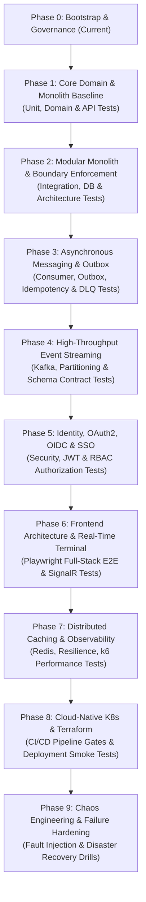

# Project & Learning Roadmap — TradeFlow

> [!IMPORTANT]
> **Adaptive Roadmap Principle**: This roadmap is problem-driven, not dogmatic. The sequence is designed to simulate the realistic architectural evolution of a high-growth system. However, **this roadmap will adapt when new engineering bottlenecks, operational friction, or specific learning needs emerge**. Stages are entered only when current architectural boundaries create genuine pressure to evolve.
>
> **Continuous Testing Integration**: Testing is not a segregated phase; it is an integrated engineering axis. Every milestone includes dedicated testing disciplines tailored to that stage's architecture.

---

## Roadmap Overview

---

## Phase Details, Architecture & Testing Milestones

### Phase 0: Project Governance & Learning Harness (Current Stage)
- [x] Establish root contract [`AGENTS.md`](file:///g:/Estudo/FullStack-Engineer-Plan/TradeFlow/AGENTS.md)
- [x] Define mentor rules, session workflow, and testing curriculum in [`.agents/rules/study-harness.md`](file:///g:/Estudo/FullStack-Engineer-Plan/TradeFlow/.agents/rules/study-harness.md)
- [x] Setup persistent context, learning state, roadmap, ADR framework, and session logs
- **Gate to Next Phase**: Complete initial setup and harness improvements without prematurely scaffolding application code.

---

### Phase 1: Core Domain & Clean Monolith Baseline
- **Business Focus**: Core trade order lifecycle (placing orders, validation, execution matching, state transitions).
- **Architectural Topics**:
  - Domain-Driven Design (DDD) tactical patterns: Entities, Value Objects, Aggregates, Invariants.
  - Clean Architecture / Vertical Slice Architecture trade-offs.
  - Relational persistence with PostgreSQL & EF Core.
  - ACID transaction boundaries within a single database.
- **Continuous Testing Focus (Early Stage: Unit, Domain & API Tests)**:
  - **Unit & Domain Tests**: Pure business rules, aggregate invariant protection, boundary conditions, deterministic AAA tests.
  - **Mocking Trade-offs**: Learning when mocking is harmful vs. using real state; avoiding tests coupled to internal private implementation.
  - **API Tests**: Testing HTTP contracts with `WebApplicationFactory`, model validation, RFC 7807 Problem Details error responses, serialization, and idempotency headers.
- **Resilience & Failure Drills**:
  - Optimistic vs. pessimistic concurrency conflicts during simultaneous trade placement.
  - Data integrity invariant enforcement under concurrent database commits.
- **Gate to Next Phase**:
  1. Ability to defend aggregate boundaries and transactional consistency invariants independently.
  2. Domain invariants covered with high-value unit tests (zero mock coupling).
  3. API error contracts verified.

---

### Phase 2: Modular Monolith & Strict Boundary Enforcement
- **Business Focus**: Introducing Portfolio, Risk Management, and Account Balances contexts.
- **Architectural Topics**:
  - Splitting a monolith into distinct modules within a single deployment unit.
  - Schema isolation in PostgreSQL (separate schemas / tables per module).
  - Inter-module communication patterns: In-memory events vs. public contracts.
  - Preventing leaky abstractions and accidental direct coupling.
- **Continuous Testing Focus (Modular Monolith: Integration, DB & Architecture Tests)**:
  - **Integration Tests with Testcontainers**: Testing against real PostgreSQL containers; avoiding in-memory EF Core limitations.
  - **Database Behavior Tests**: Transaction rollback verification, constraint enforcement, and query performance.
  - **Architecture Tests with NetArchTest**: Automated enforcement of layer independence (Domain has no outer references) and bounded-context isolation (Module A cannot reference Module B's internal models).
- **Resilience & Failure Drills**:
  - Accidental cross-module circular dependencies.
  - Performance degradation caused by synchronous in-memory cascades.
- **Gate to Next Phase**:
  1. Zero unauthorized cross-module internal dependencies verified by automated NetArchTest rules.
  2. Database integration verified with real Testcontainers (no in-memory DB fakes).

---

### Phase 3: Asynchronous Messaging & Transactional Outbox (RabbitMQ)
- **Business Focus**: Decoupling order execution from trade notifications and external compliance reporting.
- **Architectural Topics**:
  - The Dual-Write Problem: Why direct HTTP or immediate message publishing after DB commit fails.
  - The Transactional Outbox Pattern: Polling publisher vs. Change Data Capture (CDC).
  - RabbitMQ architecture: Exchanges (direct, topic, fanout), Queues, Bindings, Routing Keys.
  - Consumer reliability: Acknowledgments, prefetch counts, Dead-Letter Exchanges (DLX), poison message handling.
  - At-least-once delivery guarantees and Idempotent Consumers.
- **Continuous Testing Focus (Messaging Tests)**:
  - **Publisher Tests**: Verifying transactional outbox table persistence within the domain database transaction.
  - **Consumer Tests with RabbitMQ Testcontainers**: Testing real AMQP dispatch, consumption, and acknowledgment.
  - **Idempotency Tests**: Proving consumers safely handle duplicate message deliveries without corrupting balances or double-executing trades.
  - **Retry & DLQ Tests**: Simulating poison messages and verifying automatic routing to Dead-Letter Queues after max retry exhaustion.
  - **Event Contract Tests**: Verifying event schema serialization and contract compatibility.
- **Resilience & Failure Drills**:
  - Simulating consumer crash after DB insert but before broker ACK.
  - Network partition between the application and RabbitMQ.
  - Duplicate message delivery and out-of-order processing.
- **Gate to Next Phase**:
  1. Passing simulated consumer crash and broker outage without data loss or duplicate side-effects.
  2. Automated tests proving idempotency under duplicate message delivery.

---

### Phase 4: High-Throughput Event Streaming (Apache Kafka)
- **Business Focus**: High-frequency market data feeds, audit logs, and trade analytics ingestion.
- **Architectural Topics**:
  - RabbitMQ vs. Kafka: Queue broker vs. distributed append-only commit log.
  - Kafka core primitives: Topics, Partitions, Offset commits, Consumer Groups.
  - Message ordering within partitions and partition key selection strategies.
  - Exactly-once processing (EOS) semantics vs. at-least-once with idempotency.
- **Continuous Testing Focus (Distributed & Contract Tests)**:
  - **Kafka Service Integration Tests**: Testing with Kafka Testcontainers; verifying partition assignment and offset commits.
  - **Partition Ordering Tests**: Verifying trade sequence preservation per instrument partition key.
  - **Consumer Rebalance Resilience Tests**: Simulating consumer node crashes and validating seamless partition rebalancing.
  - **Schema Evolution & Contract Tests**: Verifying backward/forward schema compatibility as event versions change.
- **Resilience & Failure Drills**:
  - Rebalance storm when a consumer node crashes under high load.
  - Poison pill message blocking partition progress.
- **Gate to Next Phase**:
  1. Clear explanation of when to choose RabbitMQ over Kafka (and vice versa) backed by architectural trade-offs.
  2. Automated verification of partition order preservation under consumer recovery.

---

### Phase 5: Identity, Security & Single Sign-On (OAuth2 / OIDC)
- **Business Focus**: Multi-tenant institutional investor access, role-based trading limits, and API security.
- **Architectural Topics**:
  - Identity Provider (IdP) integration (Keycloak / Duende IdentityServer).
  - OAuth2 Grant Types: Authorization Code Flow with PKCE, Client Credentials.
  - OpenID Connect (OIDC) ID tokens vs. OAuth2 Access tokens.
  - JWT structure, cryptographic validation, public key caching (JWKS), and revocation strategies.
  - Fine-grained authorization: Role-Based (RBAC) and Attribute-Based (ABAC) access control.
- **Continuous Testing Focus (Security Tests)**:
  - **Authentication Testing**: Testing valid tokens, expired tokens, forged signatures, and malformed JWTs.
  - **Authorization Testing**: Automated verification of endpoint permission matrices, role limits, and tenant boundaries.
  - **Broken Access Control (IDOR) Testing**: Verifying User A cannot inspect or cancel User B's trade orders.
  - **Security-Sensitive Edge Cases**: Testing revoked refresh tokens and JWKS rotation failures.
- **Resilience & Failure Drills**:
  - Token expiration during long-running background trade execution.
  - JWKS endpoint downtime / certificate rotation failure.
- **Gate to Next Phase**:
  1. Independent architectural breakdown of token lifecycle, replay defenses, and SSO trust boundaries.
  2. Comprehensive automated security test suite covering authentication and authorization failure modes.

---

### Phase 6: Frontend Architecture & Real-Time Trading Dashboard (React)
- **Business Focus**: Institutional trading terminal with live order book, portfolio telemetry, and instant order placement.
- **Architectural Topics**:
  - React application architecture: Modular feature slices, custom hooks, presentation vs. container patterns.
  - Real-time communication: WebSockets, SignalR backplane, connection reconnection strategies.
  - Frontend state management: Optimistic UI updates, server-state caching (React Query / TanStack Query).
  - Frontend security: Token storage (BFF pattern vs. secure cookies), XSS and CSRF defenses.
- **Continuous Testing Focus (End-to-End Tests with Playwright)**:
  - **Critical User Journeys**: Automated browser testing of trade placement from UI button click to order book confirmation.
  - **Full-Stack Authentication E2E**: Testing login, token refresh, and permission-restricted views.
  - **Real-Time SignalR E2E**: Verifying live order status updates appear in the browser without manual refresh.
  - **Failure UI Handling**: Testing offline banners, reconnection attempts, and optimistic rollback on backend rejection.
  - **E2E Discipline**: Reserving E2E tests strictly for high-value user paths while keeping edge cases in unit/API tests.
- **Resilience & Failure Drills**:
  - Handling intermittent WebSocket disconnects without dropping live order status updates.
  - Race conditions in rapid UI order submissions.
- **Gate to Next Phase**:
  1. Clean frontend-backend contract with resilient reconnection and zero state drift.
  2. Playwright E2E suite covering critical trade paths reliably with zero test flakiness.

---

### Phase 7: Distributed Caching (Redis), Resiliency & Observability
- **Business Focus**: Ultra-low latency trade quotation lookups and enterprise operational visibility.
- **Architectural Topics**:
  - Redis caching patterns: Cache-Aside, Write-Through, Cache Stampede prevention (distributed locking / probabilistic early expiration).
  - Resiliency patterns via Polly: Circuit Breaker, Exponential Backoff, Fallbacks, Bulkheads.
  - Full-stack Observability: OpenTelemetry, structured logging with correlation IDs, Prometheus metrics, Grafana dashboards, Jaeger distributed tracing.
- **Continuous Testing Focus (Resilience & Performance Tests)**:
  - **Resilience Testing**: Testing Polly policies with simulated downstream HTTP timeouts and intermittent network faults.
  - **Cache Stampede Tests**: Verifying Redis cache-aside under concurrent thread contention.
  - **Performance & Load Testing with k6**: Benchmarking p95 and p99 latency under simulated trade load; identifying database and API bottlenecks.
  - **Observability Validation**: Verifying that OpenTelemetry trace contexts propagate correctly across HTTP and message boundaries.
- **Resilience & Failure Drills**:
  - Simulating Redis outage under peak quotation traffic (database protection).
  - Cascading failure under slow downstream HTTP dependencies.
- **Gate to Next Phase**:
  1. Diagnosing and root-causing an injected production bottleneck using only traces and metrics.
  2. Load test baseline established with k6 proving sub-100ms p99 latency under concurrency.

---

### Phase 8: Cloud-Native Infrastructure & Azure Deployment (Docker, K8s, Terraform)
- **Business Focus**: Automated provisioning and production-grade hosting on Microsoft Azure.
- **Architectural Topics**:
  - Multi-stage Docker packaging, non-root containers, vulnerability scanning.
  - Infrastructure as Code (IaC) with Terraform: State management, modules, environments.
  - Kubernetes (AKS): Pods, Deployments, StatefulSets, Services, Ingress Controllers, Secrets management.
  - Automated CI/CD pipelines (GitHub Actions): Build, lint, architecture test, security scan, deploy.
- **Continuous Testing Focus (Infrastructure & Pipeline Gates)**:
  - **Automated CI/CD Quality Gates**: Enforcing test hierarchy execution (Unit → Arch → Integration → Security).
  - **Deployment Smoke Tests**: Automated health check and sanity verification post-deployment in Kubernetes.
  - **Configuration & Secrets Verification**: Automated validation of environment variables and Key Vault bindings.
- **Resilience & Failure Drills**:
  - Node failure and Pod eviction during high trade volume.
  - Secret rotation failure in Azure Key Vault.
- **Gate to Next Phase**:
  1. Zero-downtime rolling deployment verified in a Kubernetes cluster.
  2. All automated test suites running deterministically within the CI/CD pipeline.

---

### Phase 9: Chaos Engineering & Disaster Recovery
- **Business Focus**: Business continuity, disaster recovery, and regulatory compliance.
- **Architectural Topics**:
  - Chaos engineering drills (Chaos Mesh / automated fault injection).
  - Database failover testing and recovery time objective (RTO) / recovery point objective (RPO) validation.
  - Cross-region backup and active-passive disaster recovery strategies.
- **Continuous Testing Focus (Chaos & Failure Testing)**:
  - Automated fault injection (killing broker pods, network delay injection, database primary failover).
  - Disaster recovery drills: Measuring actual RTO/RPO during unplanned database failover.
- **Final Milestone**: Comprehensive technical interview defense of the complete TradeFlow architecture and testing strategy.
