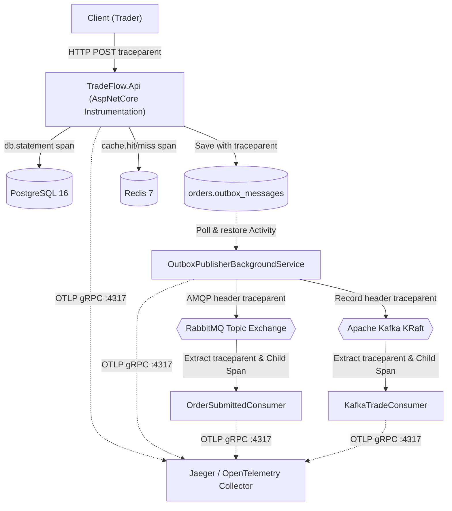

# ADR-0015: End-to-End Distributed Tracing with OpenTelemetry, W3C TraceContext, and Outbox Propagation

- **Status**: Accepted
- **Date**: 2026-11-03
- **Deciders**: Architecture & Engineering Mentor / Developer
- **Phase**: Phase 7 — Distributed Tracing & Observability

---

## 1. Context & Problem Statement

TradeFlow has evolved into a distributed-capable Modular Monolith comprising multiple decoupled runtime components:
- Inbound HTTP Minimal APIs protected by Keycloak OAuth2/OIDC (`RS256` JWT).
- PostgreSQL 16 with isolated schemas (`orders`, `inventory`) and pessimistic row locking.
- Redis 7 distributed cache with single-flight mutex coordination.
- Transactional Outbox processor polling database records via `SKIP LOCKED`.
- RabbitMQ 4 topic exchanges with push-based asynchronous consumer workers.
- Apache Kafka KRaft event stream partitioned by `ProductId` with consumer group analytics.

### The Observability Gap
In high-throughput trading, a single business transaction (e.g., submitting an order) traverses synchronous and asynchronous boundaries:
1. `Client` $\rightarrow$ `HTTP API` ($100\,\text{ms}$)
2. `API` $\rightarrow$ `PostgreSQL` (Order update + Stock reservation + Outbox record)
3. `PostgreSQL Outbox` $\rightarrow$ `Background Worker` (poll latency $\sim 1\text{--}2\,\text{s}$)
4. `Background Worker` $\rightarrow$ `RabbitMQ` $\rightarrow$ `Invoice Consumer`
5. `Background Worker` $\rightarrow$ `Kafka` $\rightarrow$ `Market Analytics Stream`

When latency spikes or a downstream consumer fails, traditional logging (even with manual `CorrelationId`) introduces critical production liabilities:
- **Loss of Causality & Hierarchy**: Logs cannot distinguish parent operations from child operations, nor parallel branches from sequential steps.
- **No Latency Waterfall**: Teams cannot pinpoint whether latency was caused by network transfer, database lock contention, Redis serialization, or broker queuing.
- **The Outbox Context-Loss Barrier**: In .NET, in-memory ambient trace contexts (`Activity.Current` / `AsyncLocal`) terminate when the HTTP response completes. Once an event is written to `orders.outbox_messages` and picked up seconds later by a background service, the trace context is lost. Downstream messaging appears disconnected from the original user action.

---

## 2. Decision

We adopt **OpenTelemetry (OTel)** as the vendor-neutral telemetry standard for TradeFlow, implementing **End-to-End Distributed Tracing** with **W3C TraceContext** and **Asynchronous Outbox Propagation**:

### 2.1 Standardized Telemetry Stack
1. **OpenTelemetry .NET SDK & Hosting**: Configure OpenTelemetry TracerProvider during host bootstrap (`AddOpenTelemetry().WithTracing(...)`).
2. **Standard Diagnostic Instrumentations**:
   - `OpenTelemetry.Instrumentation.AspNetCore`: Automatically creates Server Spans for incoming HTTP requests and extracts W3C `traceparent` headers.
   - `OpenTelemetry.Instrumentation.Http`: Instruments outgoing HTTP calls.
   - `Npgsql.OpenTelemetry` / `OpenTelemetry.Instrumentation.EntityFrameworkCore`: Generates Client Spans for database queries, execution duration, and schema statements (`db.system = postgresql`).
   - `OpenTelemetry.Instrumentation.StackExchangeRedis`: Instruments Redis commands (`GET`, `SET`, `DEL`).
3. **Custom Domain ActivitySource**: Register `TradeFlowActivitySource` (`"TradeFlow"`) to capture business-level spans and domain attributes without polluting core domain logic.

### 2.2 W3C TraceContext Outbox Propagation
To bridge the persistence barrier:
1. **Schema Evolution**: Add `trace_parent` (`VARCHAR(256)`) and `trace_state` (`VARCHAR(512)`) nullable columns to `orders.outbox_messages`.
2. **Capture at Commit**: In `DomainEventsToOutboxMessagesInterceptor`, read `Activity.Current?.Id` (the active W3C `traceparent` string) and store it alongside the serialized domain event.
3. **Restore at Publish**: When `OutboxPublisher` processes pending records, it parses the stored `trace_parent` and creates a producer Span (`ActivityKind.Producer`).
4. **Header Injection**:
   - RabbitMQ: Injects `traceparent` into `IBasicProperties.Headers` via OpenTelemetry `Propagators.DefaultTextMapPropagator`.
   - Kafka: Injects `traceparent` into Kafka record `Headers`.
5. **Consumer Extraction**: Background consumers extract the `traceparent` header upon message arrival, initiating a child Span (`ActivityKind.Consumer`) linked directly to the originating HTTP request.

### 2.3 Exporter & Local Environment
- Export traces via standard **OpenTelemetry Protocol (OTLP)** over gRPC (`http://localhost:4317`).
- Provision **Jaeger v2 / OpenTelemetry all-in-one** container in `docker-compose.yml` exposing:
  - Port `4317`: OTLP gRPC receiver.
  - Port `4318`: OTLP HTTP receiver.
  - Port `16686`: Jaeger Web UI for visualizing waterfall trace timelines.

---

## 3. Options Considered

### Option A: Manual CorrelationId in Logging (Rejected)
- *Pros*: Simple, no extra dependencies.
- *Cons*: No causality, no latency waterfall, high log storage costs, impossible to automate APM service dependency mapping.

### Option B: Proprietary APM Agents (Datadog / New Relic / Dynatrace bytecode injection) (Rejected)
- *Pros*: Auto-instrumentation with minimal code.
- *Cons*: Vendor lock-in, proprietary licensing, high costs, opacity into how async contexts are bridged across outbox tables.

### Option C: OpenTelemetry .NET SDK with W3C TraceContext & Outbox Propagation (Selected)
- *Pros*: Vendor-neutral industry standard (CNCF), zero runtime allocation when tracing is disabled, native .NET `System.Diagnostics` integration, seamless bridge across outbox boundaries, portable to any backend (Jaeger, Tempo, Datadog, Honeycomb).
- *Cons*: Requires deliberate design for outbox schema propagation and messaging headers.

---

## 4. Trade-offs & Consequences

### Positive Consequences (Gains)
- **Unified Distributed Waterfall**: Complete visualization of request lifecycle across HTTP, PostgreSQL, Redis, RabbitMQ, and Kafka in a single UI screen.
- **Pinpoint Bottleneck Discovery**: Instantly isolate whether latency is in PostgreSQL row locks, Redis serialization, broker network latency, or consumer processing.
- **Vendor Independence**: Switch backends (e.g. from Jaeger to Grafana Tempo or AWS X-Ray) simply by updating OTLP endpoint configuration, without code changes.
- **Root Cause Isolation for Background Failures**: Poison messages or consumer exceptions in RabbitMQ/Kafka immediately link back to the exact user, tenant, and HTTP request that triggered them.

### Negative Consequences (Costs & Liabilities)
- **Minor Outbox Storage Overhead**: Adding `trace_parent` column adds $\sim 55\text{--}100$ bytes per row in `orders.outbox_messages`.
- **CPU & Network Overhead**: Serializing and exporting spans via OTLP introduces nominal CPU usage ($1\text{--}3\%$), managed in production via probabilistic or tail-based sampling.

---

## 5. Conditions for Revisiting

- **Trace Ingestion Cost Saturation**: If high-frequency trade volumes (e.g. $> 100{,}000$ market ticks/sec) overwhelm the OTLP collector, revisit to implement **head-based or tail-based sampling** (e.g., sample $1\%$ of successful reads, $100\%$ of writes and errors).
