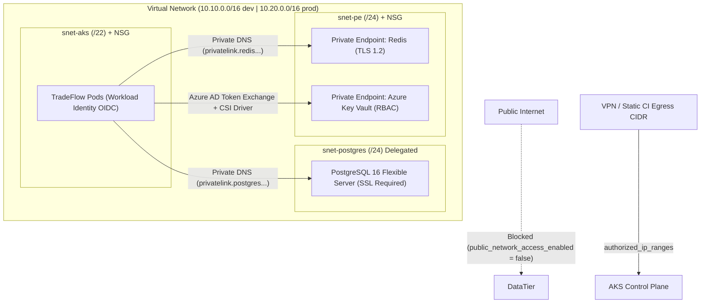

# TradeFlow Infrastructure as Code (Terraform on Microsoft Azure)

This directory contains the declarative Azure cloud topology for **TradeFlow**, implemented according to [`ADR-0019`](../../docs/adr/0019-infrastructure-as-code-terraform-azure-remote-state-and-linting-gates.md).

---

## 1. Network & Security Topology



### Core Security Guarantees
1. **Remote State & Locking (`backend.tf`)**: State is stored in an Azure Storage Account (`sttradeflowtfstate`) using Entra ID authentication (`use_azuread_auth = true`) and native **Azure Blob Lease Locking**. Never store `.tfstate` in Git.
2. **Zero Public Database Exposure**: PostgreSQL (`delegated_subnet_id`) and Redis (`Private Endpoint`) disable public network access (`public_network_access_enabled = false`).
3. **Zero Plaintext Secrets in `.tf`**: `random_password` generates cryptographically secure database credentials directly inside Terraform state and persists connection strings into Azure Key Vault (`azurerm_key_vault_secret`).
4. **Workload Identity (Secretless Pod Auth)**: AKS enables OIDC Issuer federation so pods authenticate to Azure Key Vault via Kubernetes `ServiceAccount` (`tradeflow-api-sa`) without embedding static secrets in Kubernetes manifests.

---

## 2. One-Time Remote State Bootstrap (Per Subscription)

Before executing `terraform init` against Azure for the first time, provision the remote state backend Storage Account:

```bash
az group create --name rg-tradeflow-tfstate --location eastus2
az storage account create \
  --name sttradeflowtfstate \
  --resource-group rg-tradeflow-tfstate \
  --location eastus2 \
  --sku Standard_LRS \
  --min-tls-version TLS1_2 \
  --allow-blob-public-access false
az storage container create --name tfstate --account-name sttradeflowtfstate --auth-mode login
```

---

## 3. Environment Execution Workflow

> **Important Networking Note**: Because `azurerm_key_vault` sets `public_network_access_enabled = false`, `terraform apply` (which writes `azurerm_key_vault_secret` over the Key Vault data plane) must execute from a self-hosted CI runner inside the VNet or a workstation connected over Private Link / VPN.

```bash
cd infra/terraform/environments/dev
cp terraform.tfvars.example terraform.tfvars
terraform init
terraform plan -out=tfplan
terraform apply tfplan
```

---

## 4. Zero-Cost CI/CD Static Validation Gates

Every Pull Request validates Terraform code in GitHub Actions (`.github/workflows/ci-cd.yml`) at **\$0 cloud cost**:
1. `terraform fmt -check -recursive`
2. `terraform init -backend=false` + `terraform validate` (for both `dev` and `prod`)
3. `tflint --recursive` (with `tflint-ruleset-azurerm`)
4. `trivy config` (Static IaC security & compliance audit)
